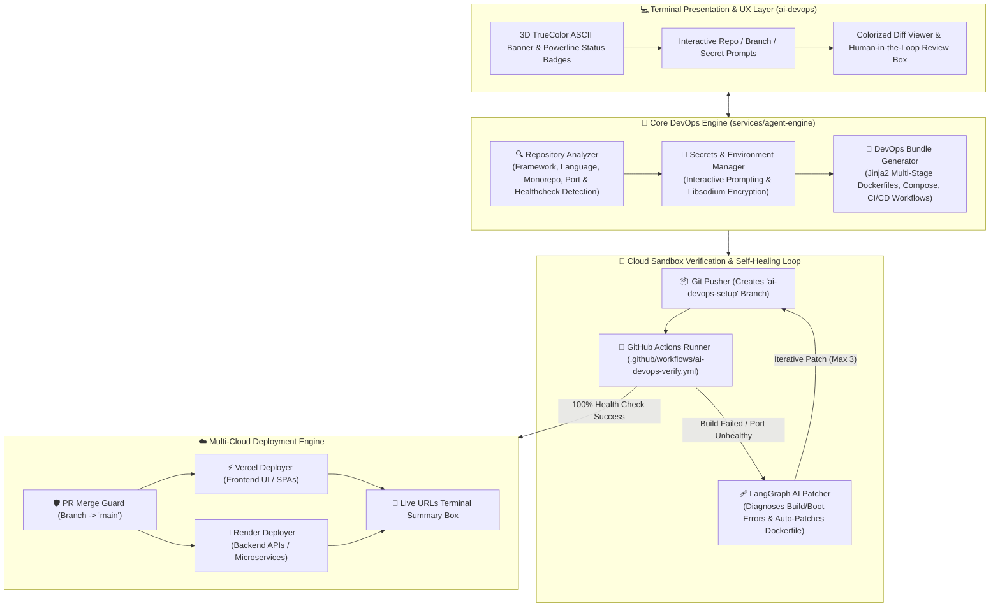

# 🚀 AI DevOps Agent (`DeployMind`)

An autonomous, terminal-native AI DevOps platform with deterministic AST repository analysis, multi-service containerization, LangGraph-powered self-healing patches, and automated multi-cloud deployment — designed to run 100% inside your terminal with rich 3D TrueColor aesthetics.

---

## ⚡ Instant Terminal CLI Install (Zero-Clone)

Any user can install and run the **DeployMind (`ai-devops`)** terminal agent globally with a single command — **no repository cloning needed**:

### Option 1: Install with `pip`
```bash
pip install  --force https://github.com/ganeshbirajdar286/DeployMind/releases/download/v0.1.0/ai_devops_agent-0.1.0-py3-none-any.whl
```

### Option 2: Install with `uv` (Recommended for isolated global CLI tool)
```bash
uv tool install --force https://github.com/ganeshbirajdar286/DeployMind/releases/download/v0.1.1/ai_devops_agent-0.1.1-py3-none-any.whl
```

### 🚀 Launch Terminal Agent
```bash
ai-devops
```
*(or alias `agent-engine`)*

---

## 🏛️ Terminal System Architecture



---

## ✨ Key Terminal Capabilities

- **3D TrueColor Terminal UI**: Stylized 6-level gradient typography, Powerline status badges, and rounded Unicode boxes with exact display width alignment.
- **Deterministic AST Repository Inspection**: Auto-detects React Vite, Next.js, Express, FastAPI, Python, and TypeScript, maps monorepos, and assigns collision-free ports.
- **Automated DevOps Bundle Generation**: Generates multi-stage production Dockerfiles, orchestrated `docker-compose.yml`, and 5 GitHub Actions workflows (`ai-devops-verify.yml`, `ci.yml`, `dependabot.yml`, `release.yml`, `stale.yml`).
- **Interactive Terminal Secrets Manager**: Safely prompts for environment variables, loads `.env` files, and encrypts secrets with `libsodium` (`pynacl`) directly into GitHub Actions Secrets.
- **Autonomous Cloud Sandbox Verification**: Dispatches isolated container builds and curls healthcheck endpoints on GitHub Actions runners.
- **LangGraph Self-Healing Loop**: If a build fails or healthcheck times out, an AI patcher diagnoses logs, patches the Dockerfile, commits, pushes, and re-tests autonomously.
- **Multi-Cloud Deployment Promotion**: Deploys verified frontends to Vercel and backends to Render, returning live production URLs.

---

## 🛠️ CLI Command Reference

### 1. Interactive Launch (Zero Arguments)
```bash
ai-devops
```
*Prompts for repository URL, branch, and GitHub token interactively.*

### 2. Autonomous Cloud Pipeline
```bash
ai-devops auto "https://github.com/owner/repo.git" --branch ai-devops-setup --token "<github_token>"
```

### 3. Inspect Repository Structure
```bash
ai-devops inspect ./my-app
```

### 4. Generate Configuration Files Directly
```bash
ai-devops generate ./my-app
```

### 5. Cloud Deployment (Render & Vercel)
```bash
ai-devops deploy ./my-app --repo owner/repo
```

---

## 🔒 Security Hardening

- **Command Injection Prevention**: Git operations use `execFile` argument lists instead of shell string interpolation, combined with strict repository regex validation (`https://github.com/owner/repo`).
- **Secret Redaction**: Environment secrets (`MONGODB_URL`, `JWT_SECRET`, `RENDER_API_KEY`, `VERCEL_TOKEN`, `DATABASE_URL`) are automatically masked (`ghp_****...`) in database records, webhooks, and live terminal streams.
- **Direct Libsodium Encryption**: Secrets uploaded to GitHub are encrypted client-side using GitHub's public key before transmission.

---

## 🧪 Running Tests

To run the complete automated test suite (38 unit tests):

```bash
cd services/agent-engine
uv run pytest
```
